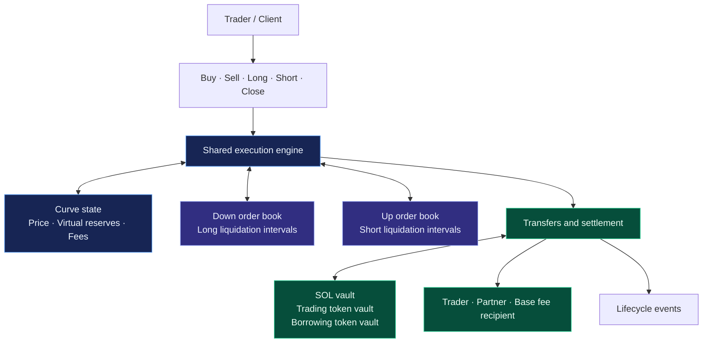
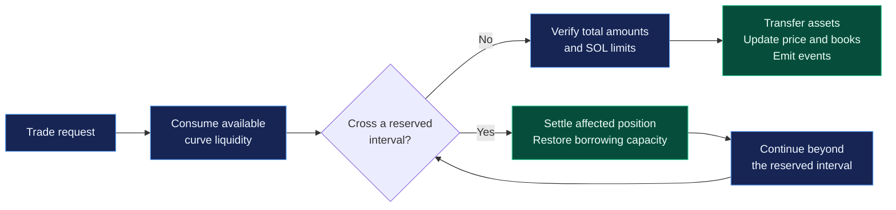

<div align="center">

# 100x.fun

### A borrowing bonding curve for Solana

**Token launches · Spot trading · Leveraged positions · Reserved liquidation liquidity**


**One curve connects token issuance, price discovery, borrowing, and position settlement.**

[Overview](#overview) · [Beyond a Basic Swap](#beyond-a-basic-swap) · [Mathematics](#the-pricing-model) · [Margin Trading](#margin-trading) · [Development](#development)

</div>

---

## Overview

100x.fun is a Solana program that combines a token launch mechanism, a constant-product spot market, and collateralized long and short positions. Built with Rust and Anchor, it manages trading liquidity, borrowing reserves, position records, fees, and settlement within a shared execution model.

Its central idea is **reserving a segment of the price curve for each position's stop-loss execution**. When a subsequent trade crosses that segment, the engine accounts for the reserved liquidity, settles the affected position, restores borrowing capacity, and continues the trade through the available curve liquidity.

This connects the price used to open a position with the liquidity model used to close it. Required collateral reflects the position's size, selected stop, execution price impact, and fees.

| Layer | Purpose |
| :--- | :--- |
| **Launch** | Create a fixed-supply SPL token, immutable on-chain metadata, trading vaults, and a borrowing allocation. |
| **Trade** | Execute spot buys and sells with explicit SOL limits. |
| **Borrow** | Open long positions by borrowing SOL, or short positions by borrowing tokens. |
| **Reserve** | Associate each position with a non-overlapping liquidation interval in its directional order book. |
| **Settle** | Support partial exits, full exits, price-triggered liquidation, and permissionless closure after expiry. |

The repository contains the on-chain program and focused mathematical tests. The **100x.fun** name is project branding; the program calculates collateral from each position's parameters and does not expose a guaranteed 100× leverage setting.

## Beyond a Basic Swap

The comparison below uses a **plain constant-product spot pool** as its baseline. Individual exchange protocols may implement additional features of their own.

| Capability | Basic spot AMM | 100x.fun |
| :--- | :--- | :--- |
| Asset exchange | Swap one reserve asset for another | Spot trading plus borrowed long and short positions |
| Token launch | Separate token issuance and pool setup | Token issuance, reserve allocation, metadata, and market creation in one instruction |
| Position state | No native debt or margin position | Tracks collateral, debt, position assets, stop intervals, and expiry |
| Collateral calculation | Outside the swap model | Derived from the full position's modeled stop-loss execution |
| Liquidation liquidity | No native reservation for borrowed positions | Explicit SOL/token amounts reserved over price intervals |
| Trade execution | Evaluate one curve movement | Traverse free curve segments and settle crossed position intervals |
| Position exits | Sell or buy assets directly | Partial close, full close, and third-party closure after expiry |
| Fee evolution | Typically a configured swap rate | Pool-relative price milestones permanently halve future pool fee rates |
| Operator economics | Protocol-specific | Configurable partner and base-recipient fee split |
| Spot trading controls | Balance and slippage checks | Adds a wallet/mint cooldown and approved-balance snapshot |

The additional capability comes from **coordinating spot liquidity and position obligations**. It does not imply universally lower slippage or more accurate external-market prices: execution still depends on the curve, available reserves, reserved intervals, and transaction limits.

## Architecture



Each market has its own curve account, two directional order books, and vaults. The order books organize **position liquidation intervals**; they are not a conventional bid/ask matching exchange.

The program maintains three distinct concepts:

- **Virtual curve reserves** determine prices and the shape of the market.
- **Borrowing reserve accounting** records available borrowing capacity and debt restoration.
- **Physical vault balances** hold actual SOL and SPL tokens and constrain transfers.

These values should not be treated as interchangeable. In particular, configuring a virtual SOL reserve does not deposit that amount of SOL into the vault.

## Token Launch and Pool Configuration

### Fixed supply, explicit allocation

A launch creates a token with **9 decimals**, divides its supply between the trading and borrowing token vaults, and initializes the market. There is no separate creator allocation in the creation flow.

For total supply $S$ in token base units and borrowing allocation $r$ expressed as an integer percentage:

$$
T_{\mathrm{borrow}}=\left\lfloor\frac{Sr}{100}\right\rfloor,
\qquad
T_{\mathrm{curve}}=S-T_{\mathrm{borrow}}
$$

$$
T_{\mathrm{curve}}+T_{\mathrm{borrow}}=S
$$

The borrowing allocation is deducted from the total supply. It is not additional issuance. The initial virtual token reserve equals the trading vault's initial allocation.

After issuance, the program revokes both **mint authority** and **freeze authority**. Metaplex metadata is created as immutable. The on-chain name, symbol, and URI are fixed; content hosted at the URI depends on the chosen storage provider.

### Standard and advanced pools

| Parameter | Standard pool | Advanced pool |
| :--- | :--- | :--- |
| Total token supply | 1,073,000,000 tokens | 10,000,000–10,000,000,000 tokens |
| Initial virtual SOL | 30 SOL | 3–100,000 SOL |
| Borrowing token allocation | 4% | 2–8% |
| Initial trading tokens | 1,030,080,000 tokens | Total supply minus borrowing allocation |
| Initial borrowing tokens | 42,920,000 tokens | Allocation formula above |
| Position duration | Inherited from partner configuration | 3–180 days |
| Initial spot fee | Inherited from partner configuration | 1–5% |
| Initial margin execution fee | Inherited from partner configuration | 1.2× the selected spot fee, using integer arithmetic |
| Fee milestone reductions | Enabled | Enabled |

Standard mode omits all five custom options. Advanced mode requires **all five together**: virtual SOL, total token supply, borrowing ratio, duration, and spot fee. Despite its name, the custom token-liquidity argument represents **total supply before the borrowing allocation is deducted**.

Standard pools inherit the configured duration; they are not hardwired to a 30-day term. Names, symbols, and metadata URIs must be nonempty and fit within 32, 10, and 200 bytes respectively.

### Launch funding

At creation, the physical SOL vault receives its live rent-exempt minimum plus a **10,000-lamport rounding buffer**. The initial virtual SOL reserve is a pricing parameter. Likewise, the initial SOL borrowing ledger of 10,000,000 SOL is virtual accounting, not a matching deposit of spendable SOL.

The token borrowing allocation, by contrast, is physically minted into a separate token vault. Token loans and repayments move tokens between that vault and the trading vault.

## The Pricing Model

### 1. Constant product, expressed through price

Let $x$ be virtual token reserves, $y$ virtual SOL reserves, and $p$ the price in SOL per token. In this section, quantities are expressed in whole tokens and SOL unless stated otherwise.

$$
K=x_0y_0,
\qquad
xy=K,
\qquad
p=\frac{y}{x}
$$

The initial reserve parameters define the invariant $K$. Given a supported price, the engine reconstructs the corresponding curve reserves:

$$
\boxed{x(p)=\sqrt{\frac{K}{p}}}
\qquad
\boxed{y(p)=\sqrt{Kp}}
$$

This price-based representation makes it possible to calculate the exact curve inventory between two prices and attach that inventory to a position's liquidation interval.

### 2. Spot execution on an uninterrupted segment

For a purchase of $q$ tokens, where $0<q<x$:

$$
C_{\mathrm{buy}}=\frac{K}{x-q}-y,
\qquad
p_{\mathrm{after}}=\frac{K}{(x-q)^2}
$$

For a sale of $q>0$ tokens:

$$
G_{\mathrm{sell}}=y-\frac{K}{x+q},
\qquad
p_{\mathrm{after}}=\frac{K}{(x+q)^2}
$$

Here $C_{\mathrm{buy}}$ is the SOL cost before fees, and $G_{\mathrm{sell}}$ is gross SOL proceeds. These formulas describe a continuous segment without intervening reserved liquidation intervals.

The public spot interface offers two explicit execution contracts:

| Action | Trader specifies | Execution condition |
| :--- | :--- | :--- |
| **Buy** | Exact token output and maximum SOL input | Total SOL cost, including the trading fee, must fit the maximum |
| **Sell** | Exact token input and minimum SOL output | SOL proceeds after the trading fee must meet the minimum |

### 3. Liquidity between two prices

For an upward movement from $p_a$ to $p_b$, with $p_b>p_a$:

$$
\Delta y=\sqrt{K}\left(\sqrt{p_b}-\sqrt{p_a}\right)
$$

$$
\Delta x=\sqrt{K}\left(\frac{1}{\sqrt{p_a}}-\frac{1}{\sqrt{p_b}}\right)
$$

The reverse movement exchanges the same idealized quantities in the opposite direction. An immediate consequence is the fee-free average execution price on an uninterrupted segment:

$$
\overline{p}=\frac{\Delta y}{\Delta x}=\sqrt{p_ap_b}
$$

This is a mathematical property of the curve, before integer rounding. It explains why collateral calculations must consider the whole closing interval: a position's average exit price differs from the price at which its exit begins.

### 4. Precision and rounding

| Quantity | Representation |
| :--- | :--- |
| SOL amounts | Integer lamports; $10^9$ lamports per SOL |
| Token amounts | Integer base units; $10^9$ units per token |
| Stored prices | Unsigned 128-bit integer with decimal scale $10^{23}$ |
| Curve arithmetic | Checked decimal calculations, including square roots |
| Fee rates | Integer numerator over $100{,}000$ |

$$
P_{\mathrm{stored}}=\left\lfloor 10^{23}p\right\rfloor
$$

Curve amount conversions generally round to the nearest base unit; stored prices round down. Fee calculations use explicit rounding rules described below. Reserve reconstruction rejects prices below $10^{-11}$ SOL per token, and arithmetic conversions enforce upper bounds.

Clients should preserve integer precision when decoding prices, amounts, and order IDs. A stored price is a decimal-scaled integer, not a binary Q64.64 value.

## Reserved Liquidation Intervals

### A position reserves an execution path

A stop price identifies where liquidation begins. Closing the full position moves the curve further, so each order records both an **interval start** and an **interval end**, together with the SOL and token amounts represented by that interval.

- A **long** reserves a downward interval for selling its position tokens.
- A **short** reserves an upward interval for repurchasing its borrowed tokens.
- Intervals within the same directional book require strict gaps: they cannot overlap or touch.
- Neighboring orders store the free curve liquidity between their intervals.

Position opening evaluates candidate insertion locations, fits the interval around existing reservations, and verifies collateral and liquidity. If no supplied candidate is usable, the instruction fails.

### Trading through a reservation



Purchases move upward through the **short** order book. Sales move downward through the **long** order book. A crossed reservation belongs to the position being settled, so its liquidity is excluded from the amount assigned to the incoming trader.

For an upward trade from $p_a$ to $p_b$, let $\mathcal{J}$ be the crossed reservations and let $(\ell_{x,j},\ell_{y,j})$ denote each reservation's token and SOL amounts. Ignoring integer rounding:

$$
q=x(p_a)-x(p_b)-\sum_{j\in\mathcal{J}}\ell_{x,j}
$$

$$
C=y(p_b)-y(p_a)-\sum_{j\in\mathcal{J}}\ell_{y,j}
$$

For a downward trade, the corresponding differences reverse:

$$
q=x(p_b)-x(p_a)-\sum_{j\in\mathcal{J}}\ell_{x,j},
\qquad
G=y(p_a)-y(p_b)-\sum_{j\in\mathcal{J}}\ell_{y,j}
$$

The engine walks the relevant ordered intervals until it finds enough available liquidity. The instruction then handles debt restoration, fee transfers, physical token repayments where needed, order removal, and reserve reconstruction. A failing limit or account check aborts the transaction.

**Execution boundary:** liquidation requires a submitted transaction. There is no background timer or external oracle trigger in this path. The traversal path rejects execution when the current price exactly equals the relevant head order's liquidation-start boundary. Reaching a boundary and crossing its interval are distinct cases.

## Margin Trading

### Collateral derives from the exit model

Users specify a token quantity, an execution limit, a maximum margin amount, a stop price, and candidate order-book insertion positions. The program derives the required collateral from the interval it can reserve.

For the formulas below, define fee helpers on **integer lamport amounts**. Let $D=100{,}000$ and $f$ be the stored fee numerator:

$$
\operatorname{Total}_f(A)=\left\lceil\frac{A(D+f)}{D}\right\rceil
$$

$$
\operatorname{Net}_f(A)=A-\left\lfloor\frac{Af}{D}\right\rfloor
$$

These represent a fee-inclusive purchase cost and fee-net sale proceeds respectively.

### Long: borrow SOL, hold tokens

1. Calculate the SOL required to buy the requested tokens on the current execution path.
2. Reserve a downward interval for selling those tokens at the stop.
3. Calculate the collateral needed to cover the difference between borrowed SOL and fee-net stop proceeds.
4. Charge the opening execution fee separately, record the position, and reduce available SOL borrowing capacity.

Let $B$ be borrowed SOL and $V_{\mathrm{stop}}$ the modeled gross SOL proceeds from the reserved liquidation sale:

$$
\boxed{M_{\mathrm{long}}=B-\operatorname{Net}_f(V_{\mathrm{stop}})}
$$

The opening calculation checks that margin plus the modeled fee-net exit value covers the principal. The wallet funds **required margin plus the opening fee**. Position tokens remain under program control until settlement.

### Short: borrow tokens, hold SOL

1. Borrow tokens from the borrowing allocation and sell them through the curve.
2. Reserve an upward interval for buying those tokens back at the stop.
3. Calculate collateral from the fee-inclusive repurchase cost and the original gross sale proceeds.
4. Charge the opening execution fee separately and record the debt, proceeds, and reserved interval.

Let $G_{\mathrm{open}}$ be the gross opening sale proceeds and $C_{\mathrm{stop}}$ the modeled repurchase cost before fees:

$$
\boxed{M_{\mathrm{short}}=\operatorname{Total}_f(C_{\mathrm{stop}})-G_{\mathrm{open}}}
$$

The distinction between gross and net opening proceeds matters: the opening fee is collected separately from the wallet.

### Effective leverage and position terms

An explanatory leverage ratio is:

$$
L_{\mathrm{effective}}\approx\frac{N_{\mathrm{entry}}}{M_{\mathrm{required}}}
$$

Here $N_{\mathrm{entry}}$ is the position's entry notional in SOL. This is a derived ratio, not an instruction argument. Position size, stop distance, reserved liquidity, fees, and rounding all affect the collateral requirement.

Relative to the market price **before** opening execution, a long stop must be strictly below 97% of that price, and a short stop strictly above 103%. Required margin must be at least 0.002 SOL and fit within the trader's margin cap. The recorded opening price is the pre-execution curve price; it is not an average fill price.

The fee named **borrow fee** acts as a margin execution fee in these paths. It is recorded on the position at opening and reused when closing. The implementation does not calculate continuously accruing interest or periodic perpetual-futures funding payments.

### Closing and expiry

| Exit path | Behavior |
| :--- | :--- |
| **Full close** | Execute the opposite trade, restore borrowing capacity, release the position's reservation, and settle the remaining SOL value. |
| **Partial close** | Close part of the token quantity, recompute the residual reservation, update position accounting, and distribute the released value. |
| **Price-triggered liquidation** | A trade crossing the reserved interval settles the affected position inside the same transaction. |
| **Expired position** | Any caller may submit a closing instruction once the term has ended; the designated settlement account must still be the position owner's address. |

For a long with remaining margin $M$, remaining SOL debt $B$, and gross close proceeds $G_{\mathrm{close}}$:

$$
\mathrm{Payout}_{\mathrm{long}}=\operatorname{Net}_f(G_{\mathrm{close}})+M-B
$$

For a short, let $C_{\mathrm{reserved}}$ be the recomputed base repurchase cost of its remaining reserved interval, and $C_{\mathrm{close}}$ the actual base repurchase cost:

$$
\mathrm{Payout}_{\mathrm{short}}=
\operatorname{Total}_f(C_{\mathrm{reserved}})
-\operatorname{Total}_f(C_{\mathrm{close}})
$$

These payouts include any returned collateral; they are not the same as trading profit. Net profit must also account for initial margin, opening fees, earlier distributions, and transaction costs. Infeasible negative settlements fail checked arithmetic rather than becoming signed liabilities.

### Partial settlement follows the remaining curve

Closing part of a position consumes the beginning of its reserved interval. The remaining interval's start moves forward while its end stays fixed, and the surrounding liquidity accounting is updated. Consequently, the surviving position's liquidation-start price can change.

For a partial long exit, let $S_\delta$ be fee-net realized sale proceeds and $R$ the fee-net liquidation value of the remaining tokens:

$$
U_\delta=S_\delta+M+R-B,
\qquad
B_{\mathrm{repaid}}=S_\delta-U_\delta
$$

The long's remaining debt is reduced by $B_{\mathrm{repaid}}$, while its recorded margin remains unchanged in this branch.

For a partial short exit, let $C_\delta$ be the reserved repurchase cost of the consumed segment and $C_{\mathrm{exit},\delta}$ its actual repurchase cost:

$$
U_\delta=
\operatorname{Total}_f(C_\delta)
-\operatorname{Total}_f(C_{\mathrm{exit},\delta})
-1\ \mathrm{lamport}
$$

The one-lamport adjustment limits rounding overpayment on partial short closes. Remaining token debt and reserved liquidity shrink, and the short's SOL asset and margin accounting are rebalanced. These operations are not simple proportional collateral withdrawals.

A partial close must cover at least **0.02 token** and leave at least **0.01 token**. Before expiry, manual closure requires the position owner. Manual closes also enforce a five-second wait from the original opening timestamp. Expiry enables third-party closure but does not automatically submit a transaction.

## Fees and Price Milestones

### Fee units and allocation

All fee rates use denominator **100,000**. For example, a stored rate of 1,000 means 1%, and a stored rate of 20 means 0.02%. These are not conventional basis points.

Spot buys apply the fee-inclusive cost helper; spot sells apply the fee-net proceeds helper. Margin execution uses the position's recorded fee rate. Administrative configuration accepts spot rates from 0.02% to 10% and margin rates from 0.024% to 10%; advanced launches use the narrower initial ranges listed above.

For a distributable fee $F$ and partner share $s\in[0,100]$:

$$
F_{\mathrm{partner}}=\left\lfloor\frac{Fs}{100}\right\rfloor,
\qquad
F_{\mathrm{base}}=F-F_{\mathrm{partner}}
$$

The base recipient receives the remainder, preserving the total. These transfers pay configured recipients; they do not automatically compound into the curve invariant.

### Permanent milestone reductions

Each pool measures milestones against **its own initial price**. Standard and advanced pools both participate.

| Discount stage | Advancement condition | Fee multiplier relative to launch |
| :--- | :--- | :--- |
| Initial | Pool created | 1× |
| First | Price strictly exceeds $10p_0$ | Approximately 1/2× |
| Second | Price strictly exceeds $100p_0$ | Approximately 1/4× |
| Third | Price strictly exceeds $1000p_0$ | Approximately 1/8× |

Each advancement halves both current pool fee rates using integer division. **At most one stage advances per instruction that runs the milestone check.** If one trade crosses several milestones, later eligible instruction executions must satisfy the remaining thresholds to advance further.

Discounts do not reverse when price falls. Existing positions retain the fee rate recorded when they opened; later reductions affect the pool's subsequent spot trades and newly opened positions.

The close-fee transfer path also conditionally retains one lamport in the pool based on a timestamp/slot calculation. This is a small accounting adjustment, not cryptographic randomness or an additional percentage discount.

## Trading Controls and Settlement Constraints

### Spot cooldown and balance approval

A wallet/mint-specific record stores the latest spot activity timestamp and an approved token-balance snapshot.

- An existing record requires a **five-second** wait before the next spot buy or sell.
- A sale requires an initialized record and cannot exceed the approved amount.
- Successful spot trades refresh the timestamp and snapshot the resulting token balance.
- Tokens received by transfer can be registered through the approval instruction, which starts a new five-second wait.
- Selling to zero closes the cooldown account and refunds its rent. Manual cleanup also requires an empty token account and an elapsed cooldown.

This constrains rapid reuse of the same wallet/mint trading record. It does not make the market MEV-proof, and margin opening does not use this spot cooldown.

### Limits and accounting safeguards

| Control | Implemented behavior |
| :--- | :--- |
| Minimum trade size | 0.01 token for spot trades and position opening |
| Partial close sizing | At least 0.02 token closed; at least 0.01 token remaining |
| Minimum margin | 0.002 SOL |
| Stop separation | Greater than 3% from the pre-opening market price in the adverse direction |
| SOL input bound | 1,000,000 SOL on paths that validate the maximum-input argument |
| Token reconciliation tolerance | Up to 10,000 token base units, or 0.00001 token, for applicable curve consistency checks |
| Pool SOL floor | Outflows must preserve the live rent-exempt minimum, with a minimum floor of one lamport |
| Arithmetic | Checked integer/decimal operations and explicit conversion limits |
| Account validation | Program ownership, PDA seeds, mint/authority relationships, linked order books, and configured fee recipients |
| Settlement identity | Closing instructions require the position owner's settlement address |

The launch rounding buffer is consumable; it is not an extra permanent reserve floor. For close-related payouts below the destination's rent threshold, the transfer helper can route the amount to the base fee recipient when the owner's account balance is also below that threshold.

The stop model and reserve checks describe the implemented accounting rules. Actual settlement still requires sufficient physical funds, valid accounts, available compute, and a successful transaction.

## On-Chain State and Integration

### Configuration hierarchy


The administrator manages global defaults and partner configuration. Partners can create their own parameter accounts from the current defaults. New pools snapshot the relevant configuration; changes upstream do not automatically rewrite existing pools or open positions.

The first successful global-admin initialization establishes the administrator without a hardcoded initializer restriction. Deployment must initialize this account with the intended authority before opening the program for use. Later updates require the stored administrator.

### Directional order books

Each order book uses a zero-copy header and a dynamically sized array of position records, organized as a doubly linked list. The implementation supports a configured maximum of **52,000 positions per book**, subject to account sizing, rent, and transaction compute limits.

Records include ownership, a book-local order ID, interval bounds, locked SOL/token amounts, neighboring liquidity, margin, debt, position assets, realized settlement accounting, the opening fee rate, and start/expiry timestamps.

Opening and closing instructions require 1–41 candidate indices for insertion or lookup, and the program validates the relevant position. **An order ID identifies a position within its book; an index identifies its current storage location.** Removal and compaction can move records. Indexers should key positions by market, directional book, and order ID, and refresh storage indices as state changes.

Traversal stops when sufficient free liquidity is found. Its cost depends on the intervals encountered; the book's storage capacity is not a promise that every position can be processed in one transaction.

### Events

| Event family | Integration use |
| :--- | :--- |
| Token creation | Discover markets, token metadata, and launch configuration |
| Spot execution | Reconstruct trade direction, executed amounts, and terminal price |
| Margin opening | Track debt, collateral, interval bounds, duration, and position identity |
| Full closure | Track completed settlement and removed positions |
| Partial closure | Update residual position and reserved-liquidity state |
| Fee milestone | Refresh displayed pool fee rates and discount stage |

Margin opening events expose curve trade direction separately from long/short intent: opening a long buys tokens, while opening a short sells them. Trade amount fields distinguish curve execution from margin and borrowing amounts. Liquidation lists contain **storage indices**, not order IDs.

An indexer should combine events with account state, particularly after book compaction or transactions that settle several positions.

## Development

### Toolchain

| Component | Repository configuration |
| :--- | :--- |
| Rust | Edition 2021 |
| Anchor CLI | 0.32.1 |
| Solana CLI | 3.1.10 |
| JavaScript package manager | npm |
| Anchor client | 0.32.1 |
| Default provider | Localnet |

Rust dependency requirements permit compatible patch updates; the lockfile records the resolved versions. The configured localnet/devnet program address is:

```text
CYzM71ENGdE6Gjx5NWt4r12EbhGX2DnoEua5oWh8xpCz
```

This address is repository configuration, not verification of a live deployment.

### Build and focused tests

With the configured toolchain installed, run from the repository root:

```bash
npm ci
cargo check -p fun100x
cargo test -p fun100x --test test_price_limit
anchor build
```

The existing price-limit tests explore decimal arithmetic at low prices, large invariant values, and subsequent reserve calculations. They use simplified mathematical helpers and do not exercise the complete program's account flows or position lifecycle.

The Anchor test script currently points to a JavaScript test directory that is not included in this checkout. A local end-to-end setup also needs the Metaplex Token Metadata program available to the validator, a matching program deployment/keypair configuration, initialized administration, and partner parameters before token creation.

### Repository map

| Location | Responsibility |
| :--- | :--- |
| [Program entrypoints](programs/fun100x/src/lib.rs) | Public instructions for configuration, launch, trading, and closure |
| [Curve mathematics](programs/fun100x/src/curve/curve_amm.rs) | Reserve reconstruction, interval quantities, pricing, and fee arithmetic |
| [Shared trade engine](programs/fun100x/src/instructions/trade_engine.rs) | Directional execution and crossed-position settlement |
| [Position opening](programs/fun100x/src/instructions/long_short.rs) | Borrowing, collateral calculation, and interval placement |
| [Position closing](programs/fun100x/src/instructions/close_long_short.rs) | Partial/full exits and repayment accounting |
| [Order-book storage](programs/fun100x/src/instructions/orderbook_manager.rs) | Linked-list operations, resizing, and record removal |
| [Program accounts](programs/fun100x/src/instructions/pdas.rs) | Configuration, curve state, and spot cooldown records |
| [Price-limit tests](programs/fun100x/tests/test_price_limit.rs) | Focused decimal-range scenarios |

---

<div align="center">

**100x.fun — token markets with borrowing and reserved position settlement.**

</div>
